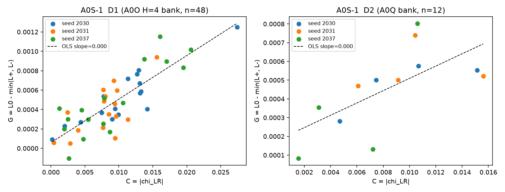
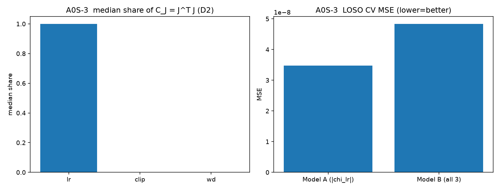

# A0S Report — Response-Based Controllability Identification
Date: 2026-09-18. Mechanism validation experiment (NOT an optimization algorithm). STOP-after-A0S round.
## 1. Hypothesis
Finite-time controllability proxy $C_t = \|J_u(t)\|$ (response magnitude) contains usable controllability information: states with larger $C_t$ achieve larger best-intervention gain $G_t = L_{baseline} - \min(L_{LR+}, L_{LR-})$, and the response sign predicts the useful action direction.
## 2. Equations
```
u = log(eta/eta0), delta = 0.05 (frozen a0o), H = 4
chi_LR = dL_score(Z_{t+H}) / du          (A0O/A0Q analytic adjoint)
C_t = |chi_LR|                            (A0S-1)
C_J = chi_lr^2 + chi_clip^2 + chi_wd^2    (A0S-3 Gramian proxy)
G_t = L0 - min(L_plus, L_minus)
best_action   = +delta if L_plus < L_minus else -delta
predicted     = +delta if chi_LR < 0 else -delta
Model A: G = alpha + beta |chi_lr|
Model B: G = alpha + b1|chi_lr| + b2|chi_clip| + b3|chi_wd|
```
## 3. Data
- **D1** (A0S-1 primary): frozen A0O stage1 cells, H=4, n=48 (seeds 2030/2031/2037 x steps 46/52/64/82 x streams 7110-7113). Analytic h_eta and rollout losses from the same record.
- **D2** (A0S-2/A0S-3 + CSV): A0Q 12 cells (seeds 2030/2031/2037 x steps 46/82 x streams 7400/7401); chi from frozen A0Q records, rollout losses from a0s_run_v01 (CRN 12/12).
## 4. Statistics
### A0S-1 magnitude vs gain (D1, n=48)
- Pearson r = +0.8324 (p = 2.26e-13)
- Spearman rho = +0.7617 (p = 3.23e-10)
- OLS: beta = 0.0449, 95% CI [0.0360, 0.0538], p = 2.26e-13, R^2 = 0.6928
- LOSO: pooled Pearson = 0.8250898609930332, pooled R^2 = 0.6806167016862931, pooled MAE = 0.00014
  - fold held-out seed 2030: beta=0.0000, pearson=0.8959923377348262, mae=0.00011
  - fold held-out seed 2031: beta=0.0001, pearson=0.6736349884934394, mae=0.00015
  - fold held-out seed 2037: beta=0.0001, pearson=0.8532945048527631, mae=0.00016
- **gate PASS**
### A0S-1 magnitude vs gain (D2, n=12)
- Pearson r = +0.6570 (p = 2.03e-02)
- Spearman rho = +0.8182 (p = 1.14e-03)
- OLS: beta = 0.0328, 95% CI [0.0063, 0.0593], p = 2.03e-02, R^2 = 0.4316
- LOSO: pooled Pearson = 0.47962788348668917, pooled R^2 = 0.1957715482822171, pooled MAE = 0.00015
  - fold held-out seed 2030: beta=0.0002, pearson=0.7925035677369332, mae=0.00008
  - fold held-out seed 2031: beta=0.0001, pearson=0.18501150923584786, mae=0.00014
  - fold held-out seed 2037: beta=0.0004, pearson=0.7401327006493538, mae=0.00024
- **gate PASS**
### A0S-2 direction prediction (D1, n=48)
- accuracy = 0.9583 (chance 0.5), binomial p = 8.36e-12
- confusion: {'TP(+delta/+delta)': 44, 'FN(-delta/+delta)': 0, 'FP(+delta/-delta)': 2, 'TN(-delta/-delta)': 2}
- **gate PASS**
### A0S-2 direction prediction (D2, n=12)
- accuracy = 1.0000 (chance 0.5), binomial p = 4.88e-04
- confusion: {'TP(+delta/+delta)': 12, 'FN(-delta/+delta)': 0, 'FP(+delta/-delta)': 0, 'TN(-delta/-delta)': 0}
- **gate PASS**
### A0S-3 controllability matrix (D2, n=12)
- median share of C_J: lr=1.0000, clip=0.0000, wd=0.0000
- LOSO Model A (|chi_lr|): MSE=3.481e-08, R^2=0.19577154828221777
- LOSO Model B (all 3):    MSE=4.836e-08, R^2=-0.11718596494613376
- adding clip/wd improves prediction: **False**
## 5. Plots


## 6. PASS/FAIL decision
```json
{
 "PASS": true,
 "fail_case": null,
 "fail_case_2_note": "A0S measures finite-H=4 controllability only; A0P showed no stable temporal decay kernel, so short-term G must NOT be read as long-term training improvement.",
 "gates": {
  "A0S-1": true,
  "A0S-2_D1": true,
  "A0S-2_D2": true,
  "A0S-3_clip_improves_over_lr_only": false
 }
}
```

**Verdict: PASS** — finite-H=4 response controllability exists: J_u carries usable information about achievable control gain, out-of-seed. Follow-on (explicit authorization only, equal-wall-clock): response-guided controller.

### FAIL case 2 statement (always reported)
A0S measures finite-H=4 controllability only; A0P showed no stable temporal decay kernel, so short-term G must NOT be read as long-term training improvement.

## 7. Restrictions honored
No controller designed; no LR schedule tuned; no neural predictor; optimizer/lambda/training dynamics untouched; delta=0.05 and H=4 frozen from a0o/a0q; all frozen artifacts read-only; report covers all seeds and streams.
