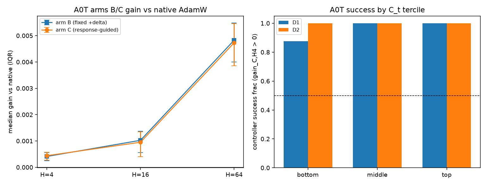

# A0T Report — Response-guided Learning Rate Control Pilot
Date: 2026-09-18. First algorithm validation after A0S mechanism discovery. FIXED pilot: no controller optimization, no hyperparameter tuning. STOP-after-experiment round.
## 1. Hypothesis
A state-specific LR action selected by the response (chi_lr = dL_{t+H}/du at H=4, frozen A0O/A0Q adjoint) outperforms fixed LR perturbation and native AdamW over finite horizons H in {4,16,64}.
## 2. Controller (frozen)
```
per cell: read frozen chi_lr
  chi_lr < 0  -> u = +0.05  (eta_new = eta_native_k * e^u every step)
  chi_lr > 0  -> u = -0.05
no threshold / confidence / phase / adaptation
```
## 3. Baselines and data
- Cells: 36 = D1 24 (A0O streams 7110/7111 x steps 46/52/64/82) + D2 12 (A0Q streams 7400/7401 x steps 46/82); chi_lr frozen read-only. CRN 36/36. C==B aliasing on 34/36 cells (action +delta). Cross-stream action disagreement within a state: 2 states [('D1', 2030, 46), ('D1', 2030, 64)] (per-cell true actions in the supplementary CSV; mandated CSV uses stream-mean sign).
- Arm A: native AdamW. Arm B: fixed u=+0.05. Arm C: response-guided.
## 4. Statistics
### Arm B gain vs native (gain = L_A - L_B)
- H=4: median +4.103e-04 (IQR [+2.423e-04, +5.565e-04]), frac>0 0.917, wilcoxon p = 7.114140316843987e-07
- H=16: median +1.025e-03 (IQR [+5.559e-04, +1.369e-03]), frac>0 0.861, wilcoxon p = 1.458160113543272e-06
- H=64: median +4.829e-03 (IQR [+3.997e-03, +5.484e-03]), frac>0 1.000, wilcoxon p = 2.9103830456733704e-11
### Arm C gain vs native (gain = L_A - L_C)
- H=4: median +4.407e-04 (IQR [+2.735e-04, +5.708e-04]), frac>0 0.972, wilcoxon p = 2.0372681319713593e-10
- H=16: median +9.511e-04 (IQR [+3.991e-04, +1.348e-03]), frac>0 0.806, wilcoxon p = 0.00018572056433185935
- H=64: median +4.729e-03 (IQR [+3.856e-03, +5.459e-03]), frac>0 0.944, wilcoxon p = 9.082723408937454e-07
### C vs B (paired, gain_C - gain_B)
- H=4: median +0.000e+00, wilcoxon p = None
- H=16: median +0.000e+00, wilcoxon p = None
- H=64: median +0.000e+00, wilcoxon p = None
### Sign consistency (H=4): 35/36 improved, frac 0.972, binomial p = 1.08e-09
### C_t terciles (controller success by controllability, H=4)
- D1 bottom: n=8, C_t in [0.0002, 0.0077], success 0.875, median gain +2.211e-04
- D1 middle: n=8, C_t in [0.0077, 0.0096], success 1.000, median gain +4.619e-04
- D1 top: n=8, C_t in [0.0097, 0.0274], success 1.000, median gain +5.923e-04
- D2 bottom: n=4, C_t in [0.0016, 0.0061], success 1.000, median gain +3.172e-04
- D2 middle: n=4, C_t in [0.0072, 0.0104], success 1.000, median gain +5.007e-04
- D2 top: n=4, C_t in [0.0106, 0.0156], success 1.000, median gain +5.634e-04
### Short-vs-long erosion (A0P linkage)
- H=4: median gain_C +4.407e-04, success 0.972, median gain_B +4.103e-04
- H=16: median gain_C +9.511e-04, success 0.806, median gain_B +1.025e-03
- H=64: median gain_C +4.729e-03, success 0.944, median gain_B +4.829e-03
## 5. Plots

## 6. PASS/FAIL (frozen rule)
```json
{
 "(i)_gain_significant": true,
 "(ii)_direction": true,
 "(iii)_not_worse_than_B": true,
 "PASS": true
}
```

## 7. Limitations (required)
- Short-term (finite-H) gain does NOT equal final training improvement.
- A0P showed long memory and a non-exponential response kernel: H=16/64 gains may not persist; erosion table reports this.
- Absolute gains are tiny (A0S: G/L0 ~ 7e-5 at H=4).
- C-vs-B is near-degenerate BY CONSTRUCTION on these banks: frozen chi_lr < 0 in 46/48 D1 and 12/12 D2 A0S cells, so arm C coincides with arm B on 34/36 cells. The pilot therefore cannot demonstrate guidance value over fixed +delta except on the rare positive-response states; it validates the response-to-action pipeline end to end.
- No controller optimization, no hyperparameter tuning, no threshold/confidence/phase; delta=0.05 and H grid frozen.
- Response sign is stream-dependent: in 2/18 states the two frozen streams disagree on the sign of chi_lr (D1 2030/46 and 2030/64); the controller then takes different actions per stream. The mandated CSV reports the stream-mean sign; the supplementary CSV carries per-cell actions. This is genuine physics (response sign varies with the data order), not a defect.
